<div align="center">

# 🛡️ AgentTrace

### AI Agent Behavioral Monitoring & Cloud Security

*Making AI agent behavior visible, explainable, and secure.*

<br/>


-FF9900?style=for-the-badge&logo=amazonwebservices&logoColor=white)


<br/>

<p>
  <a href="#-quickstart">Quickstart</a> •
  <a href="#%EF%B8%8F-architecture">Architecture</a> •
  <a href="#-demo-flow">Demo Flow</a> •
  <a href="#-deep-learning-model">DL Model</a> •
  <a href="#%EF%B8%8F-guardrails-implemented">Guardrails</a> •
  <a href="#-api-endpoints">API</a> •
  <a href="#-roadmap">Roadmap</a>
</p>

</div>

---

**AgentTrace** is a security monitoring platform for AI agents operating in AWS cloud environments. It combines real-time activity monitoring, deep learning–based behavioral analysis, IAM guardrails, and blast-radius visualization to detect and explain suspicious agent behavior.

> [!NOTE]
> AgentTrace runs fully locally. **Floci**, a free local AWS emulator, stands in for AWS, so no cloud account or credentials are needed.

---

## 📑 Table of Contents

- [Key Features](#-key-features)
- [Architecture](#%EF%B8%8F-architecture)
- [Quickstart](#-quickstart)
- [Demo Flow](#-demo-flow)
- [Deep Learning Model](#-deep-learning-model)
- [Guardrails Implemented](#%EF%B8%8F-guardrails-implemented)
- [Project Structure](#-project-structure)
- [Configuration](#-configuration)
- [API Endpoints](#-api-endpoints)
- [UI Design System](#-ui-design-system)
- [Usage Tips](#-usage-tips)
- [Troubleshooting](#-troubleshooting)
- [Roadmap](#-roadmap)
- [License](#-license) · [Acknowledgments](#-acknowledgments) · [Author](#-author)

---

## 🎯 Key Features

| | Feature | What it does |
|---|---|---|
| 📡 | **Real AWS Activity Monitoring** | Integrates with **Floci** for realistic AWS API simulation. Ingests and parses **CloudTrail** logs (polls S3 every 60s). Runs real `boto3` calls for attack scenarios (secrets access, IAM escalation, S3 deletion, etc.). |
| 🧠 | **Deep Learning Behavioral Fingerprinting** | An **LSTM autoencoder** is trained on normal agent behavior sequences. Anomalies are detected through reconstruction error. The **Gap 1 guardrail** flags rate anomalies (volume spikes) automatically. |
| ⚖️ | **Multi-Layer Risk Analysis** | **Hybrid score: 60% DL anomaly + 40% rule-based policy violations.** Gemini AI explains risk events. Compares *IAM Allowed ↔ Intended Purpose ↔ Actual Behavior* with a detailed factor breakdown. |
| 🔐 | **IAM Guardrails & Policy Optimization** | Real IAM role enforcement in Floci (`ENFORCE_IAM=1`). An automatic **least-privilege policy generator** shows unused permissions. An Intent vs Actual table flags concerning actions. |
| 💥 | **Blast Radius Visualization** | A ReactFlow graph shows **Agent → Services → Resources**, with impact estimation (CRITICAL / HIGH / LOW) and sensitive-resource highlighting. |
| 🎨 | **Modern Dark UI** | Dark design system with smooth animations, a 5-tab agent detail view, a live activity feed, reconstruction-error timelines, and attack simulation with step progression. |

**Agent detail tabs:** `Overview` · `Behavioral AI` · `Intent vs Actual` · `Blast Radius` · `Risk Events`

---

## 🏗️ Architecture

<p align="center">
  
</p>

<details>
<summary><b>Component summary</b></summary>

<br/>

| Layer | Technology | Port | Role |
|---|---|:---:|---|
| **Frontend** | React 18 · Vite · React Router · Recharts · ReactFlow | `5173` | Dashboard, agent detail, scenario simulator. Vite proxies `/api` → `8000` |
| **Backend** | FastAPI · SQLAlchemy · TensorFlow · boto3 | `8000` | Routers, CloudTrail poller, attack scenarios, ML, risk engine |
| **Database** | PostgreSQL | `5432` | Agents, activity logs, risk events, behavioral fingerprints |
| **AWS Emulator** | Floci | `4566` | S3, IAM, Secrets Manager, DynamoDB, CloudTrail, KMS |
| **Explanations** | Gemini API *(optional)* | — | Natural-language explanation of risk events |

**Backend modules**

- **Routers:** `agents` · `activity` · `risk` · `fingerprint` · `blast_radius` · `scenarios`
- **Services:** CloudTrail Poller (60s background poll) · Attack Scenarios (6 real `boto3` flows)
- **ML:** LSTM autoencoder (`behavioral_autoencoder.py`), trained on normal event sequences. Reconstruction error becomes the anomaly score, and rate anomaly detection (Gap 1) runs alongside it.

</details>

---

## 🚀 Quickstart

### Prerequisites

- **Docker** and **Docker Compose**
- *(Optional)* `GEMINI_API_KEY` for AI explanations

### 1. Clone & navigate

```bash
cd AgentTrace
```

### 2. Set environment variables

```bash
cp .env.example .env
# Edit .env to add GEMINI_API_KEY (optional)
```

### 3. Start the stack

```bash
docker-compose up --build
```

This starts four services:

| Service | URL | Description |
|---|---|---|
| **Floci** | `localhost:4566` | AWS emulator with CloudTrail |
| **PostgreSQL** | `localhost:5432` | Database |
| **Backend** | `localhost:8000` | FastAPI + ML |
| **Frontend** | `localhost:5173` | React UI |

### 4. Open the dashboard

Go to **http://localhost:5173**.

The system auto-seeds **4 demo agents** on startup, so you'll immediately see the live activity feed, risk scores and alerts, and the attack scenario simulator.

---

## 📊 Demo Flow

### Step 1 — View the dashboard

- **4 pre-seeded agents:** Sales Report Agent, Data Pipeline Agent, Customer Support Bot, DevOps Automation Agent
- **Stats cards:** Monitored Agents, Critical Alerts, Events Today, Anomalies
- **Activity timeline chart:** 14 days, normal vs anomalous events

### Step 2 — Run an attack scenario

1. Open **Attack Scenarios** in the sidebar.
2. Select an agent (e.g. Sales Report Agent).
3. Click a scenario card:

| Scenario | Severity | What it does |
|---|:---:|---|
| **Secrets Access** | 🔴 CRITICAL | Reads prod credentials |
| **IAM Escalation** | 🔴 CRITICAL | Creates an admin role |
| **S3 Deletion** | 🟠 HIGH | Deletes customer data |
| **Prod DB Access** | 🟠 HIGH | Scans a production table |
| **KMS Access** | 🟡 MEDIUM | Unusual timing |
| **Normal Baseline** | 🟢 LOW | Expected S3 / DynamoDB reads |

4. Watch real `boto3` calls execute against Floci.
5. Review the risk analysis: score ring, factors, AI explanation, recommendations.

### Step 3 — Explore the agent detail

Click any agent card on the dashboard, then walk through the 5 tabs:

<details>
<summary><b>Overview</b></summary>

- Recent activity feed (anomalies highlighted)
- Service usage radar chart
- IAM permissions tag cloud

</details>

<details>
<summary><b>Behavioral AI</b> — the most impressive tab</summary>

- Model status cards: version, threshold, events/hour stats
- **Reconstruction error timeline chart:** red dots are anomalies above the threshold
- **Rate Anomaly Guardrail:** shows volume spike detection
- Service/action frequency bar charts
- 24-hour activity heatmap

</details>

<details>
<summary><b>Intent vs Actual</b></summary>

- Table: **IAM Allowed | Intended | Actually Performed**
- Red highlights for concerning actions
- **Generate Least-Privilege Policy** button shows the JSON, with copy to clipboard

</details>

<details>
<summary><b>Blast Radius</b></summary>

- ReactFlow graph: Agent → Services → Resources
- Impact summary chips (CRITICAL / HIGH / LOW)
- Alerts for sensitive resources

</details>

<details>
<summary><b>Risk Events</b></summary>

- Timeline of all risk events
- Risk rings, factor badges, AI explanations
- Numbered recommendations
- Resolve button

</details>

### Step 4 — Build a DL fingerprint

1. Click **Build Fingerprint** in Agent Detail.
2. The backend trains the LSTM autoencoder on the last 30 days of normal activity.
3. Model metrics appear in the **Behavioral AI** tab.
4. The reconstruction error chart shows which events deviate from the learned pattern.

### Step 5 — CloudTrail sync

- Click **Sync CloudTrail** (top bar) to poll Floci S3 logs manually, or
- wait 60s for the automatic background poll.

---

## 🧠 Deep Learning Model

### Architecture: LSTM Autoencoder

```text
Input: sequence of 50 events
  ↓
[ service_id | action_id | hour | events_per_hour | time_delta ]
  ↓
Encoder:  LSTM(64) → LSTM(32) → Dense(16)
  ↓
Latent representation (16 dims)
  ↓
Decoder:  RepeatVector(50) → LSTM(32) → LSTM(64) → Dense(5)
  ↓
Reconstructed sequence
  ↓
MSE loss → Reconstruction error
```

### Anomaly detection logic

| Stage | Rule |
|---|---|
| **Training** | Only on non-anomalous events |
| **Threshold** | `mean(train_errors) + 2 * std(train_errors)` |
| **Prediction** | New sequence → reconstruction error > threshold → **anomalous** |
| **Rate anomaly (Gap 1)** | `events_per_hour > 100` is flagged regardless of pattern |

### Features per event

| # | Feature | Encoding |
|:---:|---|---|
| 1 | **Service ID** | Label-encoded, normalized |
| 2 | **Action ID** | Label-encoded, normalized |
| 3 | **Hour of day** | 0–23, normalized to 0–1 |
| 4 | **Events in current hour** | Normalized by max observed |
| 5 | **Time since last action** | Minutes, capped at 1440 |

---

## 🛡️ Guardrails Implemented

| # | Guardrail | Layer | How it works |
|:---:|---|---|---|
| 1 | **IAM Enforcement** | Infrastructure | Real IAM roles in Floci with least-privilege policies. `ENFORCE_IAM=1` in the Floci config. `AccessDenied` events are logged to CloudTrail. |
| 2 | **Application-Level Validation** | Business logic | Compares each action against `expected_services` and `expected_actions`. Flags violations before `boto3` execution. |
| 3 | **Rate Anomaly Detection (Gap 1)** | DL model | Events-per-hour is a feature in the autoencoder input. `>100 events/hour` is flagged as suspicious, detecting volume spikes regardless of action legitimacy. |
| 4 | **Behavioral Drift Detection** | DL model | The autoencoder learns normal sequences. High reconstruction error means an unusual pattern. Threshold is `mean + 2*std` of training errors. |
| 5 | **Intent vs Actual Comparison** | Compliance | Compares IAM permissions vs intended purpose vs actual usage. Highlights "technically allowed but not intended" actions. |

---

## 📁 Project Structure

```text
AgentTrace/
├── docker-compose.yml          # 4 services: floci, db, backend, frontend
├── .env.example                # Template (GEMINI_API_KEY, DB creds)
├── requirements.txt            # Python deps (FastAPI, TF, boto3, etc.)
├── docs/
│   └── architecture.svg        # Architecture diagram used in this README
├── backend/
│   ├── Dockerfile              # Python 3.11 + TensorFlow
│   ├── main.py                 # FastAPI app + CloudTrail setup + poller start
│   ├── database.py             # SQLAlchemy engine
│   ├── models.py               # Agent, ActivityLog, RiskEvent, BehavioralFingerprint
│   ├── schemas.py              # Pydantic models
│   ├── seed_data.py            # Demo agents + Floci IAM/S3/secrets setup
│   ├── routers/
│   │   ├── agents.py           # CRUD + stats
│   │   ├── activity.py         # Logs + timeline + sync endpoint
│   │   ├── risk.py             # Scoring + Gemini AI + intent comparison + LPP
│   │   ├── fingerprint.py      # DL model build + deviation + metrics
│   │   ├── blast_radius.py     # ReactFlow graph data
│   │   └── scenarios.py        # List + execute attack scenarios
│   ├── services/
│   │   ├── cloudtrail_poller.py    # Background S3 log polling (60s)
│   │   └── attack_scenarios.py     # 6 real boto3 scenario flows
│   └── ml/
│       └── behavioral_autoencoder.py   # LSTM autoencoder class
└── frontend/
    ├── Dockerfile              # Node 20 + Vite dev server
    ├── vite.config.js          # Proxy /api → backend:8000
    ├── package.json            # React, React Router, Recharts, ReactFlow
    ├── index.html
    └── src/
        ├── main.jsx            # React DOM entry
        ├── App.jsx             # Router + Layout
        ├── index.css           # Complete dark design system (80KB)
        ├── api/client.js       # Axios API functions
        ├── components/
        │   ├── Sidebar.jsx
        │   ├── TopBar.jsx
        │   ├── RiskBadge.jsx
        │   ├── RiskRing.jsx            # SVG circular progress
        │   ├── ActivityFeed.jsx
        │   └── BlastRadiusGraph.jsx    # ReactFlow wrapper
        └── pages/
            ├── Dashboard.jsx           # Main landing page
            ├── SimulateActivity.jsx    # Attack scenario execution
            ├── AgentDetail.jsx         # 5-tab agent view
            └── RegisterAgent.jsx       # Create new agent
```

---

## 🔧 Configuration

### Environment variables (`.env`)

```bash
# Database
POSTGRES_USER=agenttrace
POSTGRES_PASSWORD=agenttrace_secret
POSTGRES_DB=agenttrace

# Backend
SEED_ON_STARTUP=true
GEMINI_API_KEY=your-key-here   # Optional, falls back to rule-based

# AWS / Floci
AWS_ENDPOINT_URL=http://floci:4566
AWS_ACCESS_KEY_ID=test
AWS_SECRET_ACCESS_KEY=test
AWS_DEFAULT_REGION=us-east-1
CLOUDTRAIL_BUCKET=agenttrace-cloudtrail-logs
CLOUDTRAIL_POLL_INTERVAL=60    # seconds

# ML
ML_MODELS_DIR=/app/ml_models
```

> [!WARNING]
> The credentials above are local demo values for the Floci emulator. Change them if you ever expose this stack beyond your machine.

### Ports

| Service | Port | Notes |
|---|:---:|---|
| Frontend | `5173` | Vite dev server |
| Backend | `8000` | FastAPI, Swagger at `/docs` |
| PostgreSQL | `5432` | Database |
| Floci | `4566` | All AWS services (S3, IAM, CloudTrail, DynamoDB, Secrets, KMS) |

---

## 📚 API Endpoints

Full interactive docs at **http://localhost:8000/docs**

<details open>
<summary><b>Agents</b></summary>

| Method | Endpoint | Description |
|:---:|---|---|
| `GET` | `/api/agents/` | List all agents (with summary stats) |
| `GET` | `/api/agents/{id}` | Get agent detail |
| `POST` | `/api/agents/` | Register new agent |
| `GET` | `/api/agents/stats` | Dashboard stats |

</details>

<details>
<summary><b>Activity</b></summary>

| Method | Endpoint | Description |
|:---:|---|---|
| `GET` | `/api/activity/{agent_id}?limit=50` | Recent logs |
| `GET` | `/api/activity/{agent_id}/timeline?days=14` | Chart data |
| `POST` | `/api/activity/sync-cloudtrail` | Manually trigger CloudTrail poll |

</details>

<details>
<summary><b>Risk</b></summary>

| Method | Endpoint | Description |
|:---:|---|---|
| `GET` | `/api/risk/{agent_id}/events` | Risk events for agent |
| `GET` | `/api/risk/{agent_id}/intent-comparison` | IAM vs Intended vs Actual table |
| `GET` | `/api/risk/{agent_id}/least-privilege-policy` | Auto-generate minimal IAM policy |

</details>

<details>
<summary><b>Fingerprint</b></summary>

| Method | Endpoint | Description |
|:---:|---|---|
| `GET` | `/api/fingerprint/{agent_id}` | Get fingerprint |
| `POST` | `/api/fingerprint/{agent_id}/build` | Train DL model |
| `GET` | `/api/fingerprint/{agent_id}/model-metrics` | Reconstruction error timeline |
| `GET` | `/api/fingerprint/{agent_id}/deviation?action=X&service=Y` | Deviation score |

</details>

<details>
<summary><b>Blast Radius & Scenarios</b></summary>

| Method | Endpoint | Description |
|:---:|---|---|
| `GET` | `/api/blast-radius/{agent_id}` | ReactFlow graph data |
| `GET` | `/api/scenarios/` | List 6 attack scenarios |
| `POST` | `/api/scenarios/{scenario_id}/run/{agent_id}` | Execute real `boto3` scenario |

</details>

---

## 🎨 UI Design System

### Color palette

| Color | Hex | Usage |
|---|---|---|
|  **Indigo** | `#6366f1` | Accent (`--accent-primary`) |
|  **Green** | `#10b981` | Success, normal, low risk |
|  **Red** | `#ef4444` | Critical, anomalous |
|  **Orange** | `#f97316` | High risk |
|  **Yellow** | `#eab308` | Medium risk |
|  **Blue** | `#3b82f6` | Info, activity |
|  **Purple** | `#a855f7` | Stats |

### Key components

| Component | Description |
|---|---|
| **Stat Cards** | Colored top border, icon, value, label |
| **Agent Cards** | Hover glow effect, clickable, risk badge |
| **Scenario Cards** | Color-coded by severity, hover shadow |
| **Risk Ring** | SVG circular progress (0–100), color gradient |
| **Activity Feed** | Icon (blue = normal, red = anomalous), timestamp |
| **Badges** | Rounded pills (critical / high / medium / low / info / neutral / green) |
| **Buttons** | Primary / Secondary / Danger / Success / Ghost, with icons |
| **Tabs** | Rounded, active state with background |
| **Code Blocks** | Monospace, dark background, copy button |
| **Modals** | Backdrop blur, slide-up animation |

---

## 📖 Usage Tips

**Building fingerprints**
- Needs **20+ normal events** minimum for training; best results with **50+**.
- Retrain after major behavior changes.
- Check the "Model Performance" chart to verify threshold tuning.

**Attack scenarios**

| Scenario | Tests |
|---|---|
| Secrets Access | Sensitive resource access |
| IAM Escalation | Privilege escalation detection |
| S3 Deletion | Destructive action detection |
| Prod DB Access | Resource scope violations |
| Normal Baseline | Establishes the legitimate activity pattern |
| KMS Access | Unusual timing detection |

**Least-privilege policies**
- Generated from actual usage (non-anomalous events only).
- Shows the % reduction from current IAM permissions.
- Copy the JSON and apply it to the Floci IAM role for stricter enforcement.

**CloudTrail sync**
- Automatic poll every 60s (background thread).
- Manual sync via the **Sync CloudTrail** button (top bar).
- Logs are ingested from the `agenttrace-cloudtrail-logs` S3 bucket.
- Parsed CloudTrail JSON goes into the `ActivityLog` table.

---

## 🐛 Troubleshooting

<details>
<summary><b>Backend won't start</b></summary>

```bash
# PostgreSQL healthy?
docker-compose logs db

# Floci running?
curl http://localhost:4566/_floci/health

# TensorFlow installed?
docker exec -it agenttrace_backend pip show tensorflow
```

</details>

<details>
<summary><b>No CloudTrail logs ingested</b></summary>

```bash
# Verify the trail exists
aws --endpoint-url=http://localhost:4566 cloudtrail get-trail --name agenttrace-trail

# Check the S3 bucket
aws --endpoint-url=http://localhost:4566 s3 ls s3://agenttrace-cloudtrail-logs

# Check backend logs
docker-compose logs backend | grep CloudTrail
```

</details>

<details>
<summary><b>Frontend can't reach backend</b></summary>

- **Vite proxy:** check that `vite.config.js` proxies `/api` to `http://localhost:8000`.
- **CORS:** the backend allows all origins (`allow_origins=["*"]`).
- **Network:** open DevTools → Network tab and inspect the `/api/*` requests.

</details>

<details>
<summary><b>DL model not training</b></summary>

```bash
# Check logs
docker-compose logs backend | grep autoencoder

# Check TensorFlow
docker exec -it agenttrace_backend python -c "import tensorflow; print(tensorflow.__version__)"
```

Also verify there are enough events: **20+** are needed to form sequences.

</details>

<details>
<summary><b>Floci connection refused</b></summary>

```bash
# Container running?
docker ps | grep floci

# Test from host
curl http://localhost:4566/_floci/health
```

Also check the port mapping `4566:4566` in `docker-compose.yml`.

</details>

---

## 🚧 Roadmap

- [ ] Multi-agent correlation (cross-agent blast radius)
- [ ] Webhook alerts (Slack, email) for critical risks
- [ ] Historical risk trend charts
- [ ] Custom scenario builder (UI for defining `boto3` sequences)
- [ ] STS AssumeRole integration (temporary credentials)
- [ ] VPC network simulation in Floci
- [ ] Export risk reports as PDF
- [ ] Prometheus metrics endpoint

---

## 📄 License

MIT License. Built for educational purposes as a college project.

---

## 🙏 Acknowledgments

- [**Floci**](https://github.com/floci-io/floci): local AWS emulator (100% free, no auth tokens)
- **TensorFlow**: deep learning framework
- **FastAPI**: modern Python web framework
- **React** + **Vite**: frontend stack
- **Recharts**: charts
- **ReactFlow**: graph visualization
- **Lucide Icons**: icon set

---

## 👨‍💻 Author

Built as a 7th semester college project demonstrating:

- Multi-layer cloud security architecture
- Deep learning for behavioral anomaly detection
- Real-world AWS patterns (CloudTrail, IAM, `boto3`)
- Full-stack development (React + FastAPI + PostgreSQL + TensorFlow)
- Docker containerization
- Modern UI/UX design

<div align="center">

<br/>

**AgentTrace** — *Making AI agent behavior visible, explainable, and secure.*

</div>
